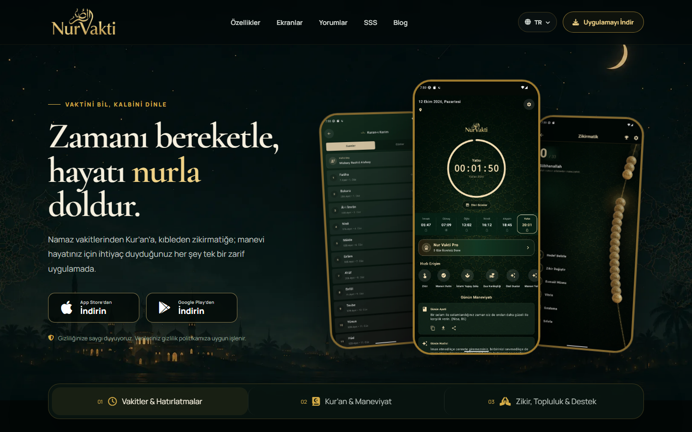
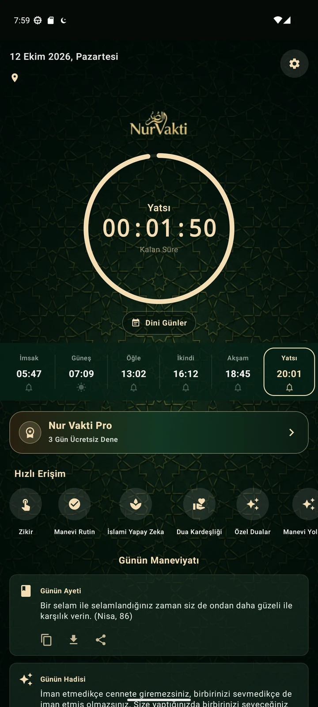
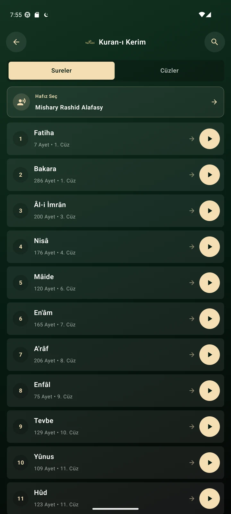
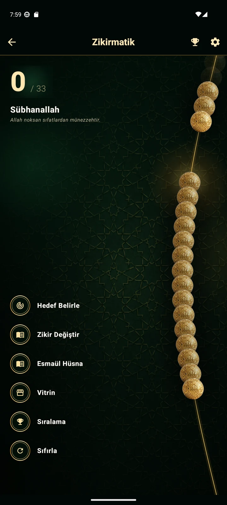

# Nur Vakti · Web

**Vaktini bil, kalbini dinle.**

Nur Vakti'nin web deneyimi için resmî tanıtım deposu.  
Namaz vakitlerinden Kur'an'a, kıbleden zikre uzanan manevi yolculuğu keşfedin.

[**Web sitesini ziyaret et**](https://www.nurvakti.app/) · [**Dini bilgiler**](https://www.nurvakti.app/blog.html) · [**Google Play**](https://play.google.com/store/apps/details?id=com.ardaozen.nurvakti) · [**App Store**](https://apps.apple.com/tr/app/nur-vakti-namaz-zikirmatik/id6758713590?l=tr)

  

## Bir bakışta Nur Vakti

- Konuma göre namaz vakitleri ve hatırlatmalar
- Kur'an-ı Kerim okuma ve dinleme
- Kıble yönü, zikir ve manevi rutin
- Dua kardeşliği, dini günler ve günlük içerikler
- Android ve iOS uygulamalarına hızlı erişim

Web sitesi; farklı ekran boyutlarına uyumlu bir deneyim, çok dilli sayfalar ve uygulamayı tanıtan içerikler sunar.

## Dini bilgiler ve rehberler

Nur Vakti'nin [dini bilgiler arşivinde](https://www.nurvakti.app/blog.html) ibadet, Kur'an ve günlük manevi yaşam üzerine rehberler bulunur. Yazıların tamamı canlı sitededir; buradaki bağlantılar sizi özgün sayfalara götürür.

**Namaz ve ibadet:** [Namaz nasıl kılınır?](https://www.nurvakti.app/namaz-nasil-kilinir.html) · [Abdest nasıl alınır?](https://www.nurvakti.app/abdest-nasil-alinir.html) · [Kaza namazı hesaplama](https://www.nurvakti.app/kaza-namazi-hesaplama.html) · [Teheccüd namazı](https://www.nurvakti.app/teheccud-namazi-nasil-kilinir.html) · [Orucu bozan durumlar](https://www.nurvakti.app/orucu-bozan-ve-bozmayan-durumlar.html)

**Kur'an, dua ve zikir:** [Ayetel Kürsi](https://www.nurvakti.app/ayetel-kursi-okunusu-ve-anlami.html) · [Yasin Suresi](https://www.nurvakti.app/yasin-suresi-okunusu-ve-fazileti.html) · [Kur'an dinlemenin faydaları](https://www.nurvakti.app/kuran-dinlemenin-faydalari.html) · [Kur'an hatmi nasıl yapılır?](https://www.nurvakti.app/kuran-hatmi-nasil-yapilir.html) · [Günlük okunacak dualar](https://www.nurvakti.app/gunluk-okunacak-dualar.html) · [Dua etmenin adabı](https://www.nurvakti.app/dua-etmenin-adabi.html) · [Esmaül Hüsna](https://www.nurvakti.app/esmaul-husna-ve-anlamlari.html) · [Zikir çekmenin faziletleri](https://www.nurvakti.app/zikir-cekmenin-faziletleri.html)

**Günlük rehber:** [Zekât nasıl hesaplanır?](https://www.nurvakti.app/zekat-nasil-hesaplanir.html) · [Kıble yönü nasıl bulunur?](https://www.nurvakti.app/kible-yonu-nasil-bulunur.html) · [2026 dini günler](https://www.nurvakti.app/islami-takvim-ve-dini-gunler.html) · [2027 dini günler](https://www.nurvakti.app/2027-dini-gunler.html) · [Kutlama mesajları](https://www.nurvakti.app/mesajlar.html)

## Uygulamadan ekranlar

<table>
  <tr>
    <td align="center"><strong>Vakitler</strong></td>
    <td align="center"><strong>Kur'an-ı Kerim</strong></td>
    <td align="center"><strong>Zikir</strong></td>
  </tr>
  <tr>
    <td align="center"></td>
    <td align="center"></td>
    <td align="center"></td>
  </tr>
</table>

## Bağlantılar

| | |
|---|---|
| Web sitesi | [nurvakti.app](https://www.nurvakti.app/) |
| Dini bilgiler | [Blog ve rehberler](https://www.nurvakti.app/blog.html) |
| Android | [Google Play'den indir](https://play.google.com/store/apps/details?id=com.ardaozen.nurvakti) |
| iOS | [App Store'dan indir](https://apps.apple.com/tr/app/nur-vakti-namaz-zikirmatik/id6758713590?l=tr) |
| Android tanıtım deposu | [Nur-Vakti-App](https://github.com/ardaaozen/Nur-Vakti-App) |
| Gizlilik politikası | [Gizlilik](https://www.nurvakti.app/gizlilik.html) |

---

**English:** This is the public showcase for the Nur Vakti website and mobile app. Visit [nurvakti.app](https://www.nurvakti.app/) to explore the product.

Bu depo yalnızca tanıtım amaçlıdır. Web sitesinin ve uygulamaların kaynak kodları burada yayımlanmaz; kaynak kodları özel depolarda tutulur. Görseller ve marka varlıkları Nur Vakti'ye aittir.

